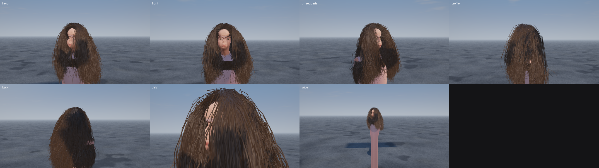
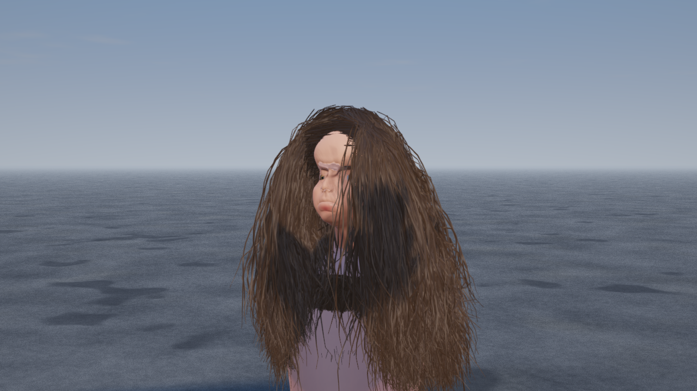
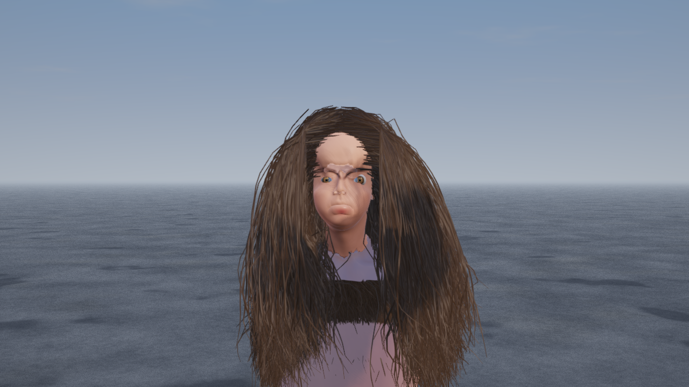
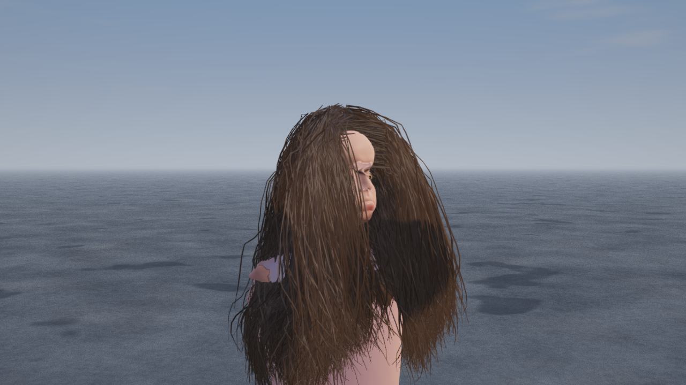
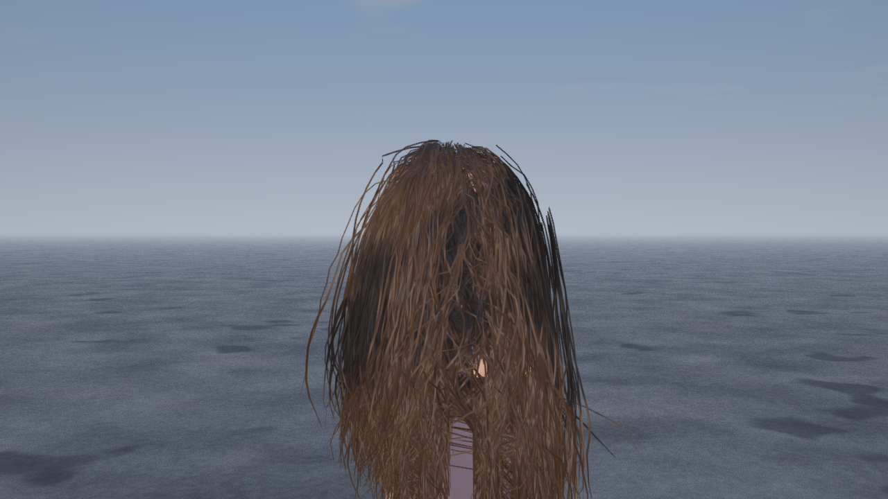
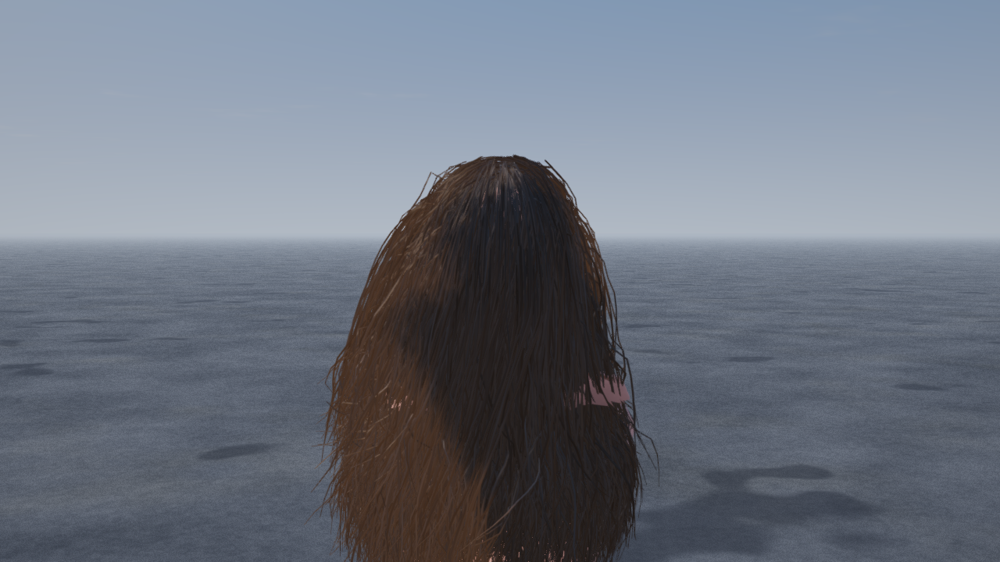
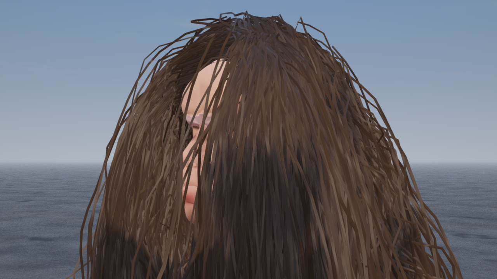
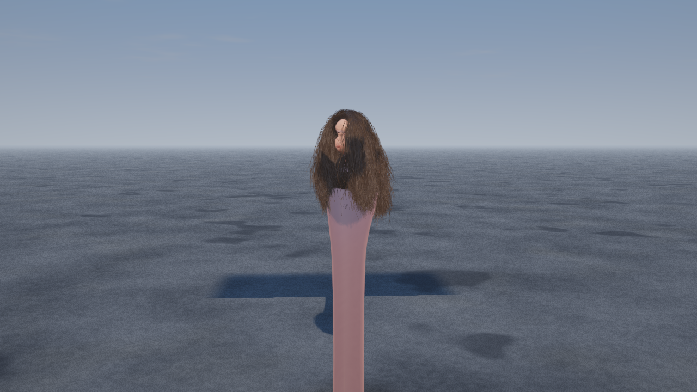
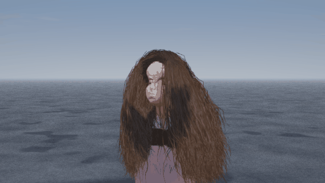

# hair-vulkan — real-time hair mesh simulation in Vulkan + C++

A from-scratch, dependency-free C++17/Vulkan 1.3 renderer that reproduces the hair
model of **"Real-time Hair Mesh Simulation" (Kui Wu & Cem Yuksel, I3D 2016)**: a
*hair mesh* (grid of 212 × 48 strands, 20 nodes each) driven by a Baraff–Witkin
style cloth solver with volume preservation, collision correction against the head
and body, gravity and a coherent wind field, rendered as camera-facing ribbons with
Kajiya–Kay anisotropic shading.

The bust is a **scanned human head** (9.3k-vertex scan, subdivided to 35k vertices),
re-sculpted into a feminine mannequin with open eyes, a neck, shoulders and a torso
continuation, and lit with a skin shader that paints brows, lashes and lips, plus a
separate eyeball pass with iris, pupil and a wet cornea.

No image proxies and no pre-baked frames: every pixel is rasterised by Vulkan on the
Mesa `lavapipe` software device (`llvmpipe (LLVM 23.1.3, 256 bits)`, Vulkan 1.4).
PNG files are only the final readback of the rendered frame.



## Stills — 1280 × 720, 4× MSAA, wind 0.45

| | |
| --- | --- |
| **hero** — three-quarter framing, centre part and the fall of the hair | **front** — the reference pose: long straight centre-parted dark hair |
|  |  |
| **threequarter** | **profile** — the bust silhouette, ear and nape |
|  |  |
| **back** — closed hair mass, sheen along the strands | **detail** — strands, part line, skin and eyes |
|  |  |

**wide** — sky, ground, the whole bust and its cast shadow:



## Animation — wind + collision + orbiting camera

Simulated frames (wind 0.7): the hair is moved only by the solver, the scanned head
and the ground colliders — no keyframed geometry:



## The head

`assets/head.obj` is built by `tools/build_head_asset.py` from the *Infinite-Level 02*
head scan by **Lee Perry-Smith** (CC-BY 3.0, triplegangers / ir-ltd, as distributed
with three.js). The script:

1. welds the scan (9 279 → 8 844 verts) and runs one step of Loop subdivision,
2. sculpts it towards a feminine bust — jaw taper, softer brow ridge, rounder
   forehead, narrower nose, fuller lips, lifted cheekbones, slimmer neck,
3. cuts an almond **palpebral opening** through the closed lids of the scan and adds
   two eyeballs (`assets/eyes.obj`), so the head has open eyes,
4. cuts the scan where the procedural torso takes over,
5. bakes `assets/head_sdf.bin`, a 98 × 94 × 64 signed-distance field of the bust
   quantised to 2 mm — this is what the hair collides with.

```bash
python3 tools/build_head_asset.py path/to/LeePerrySmith.glb assets
```

The renderer loads the assets at start-up (`--assets <dir>`, default `assets`);
without them it falls back to the older procedural head and a warning is printed.

**Attribution:** the head geometry is derived from the Lee Perry-Smith head scan,
© Infinite Studio / ir-ltd, licensed CC-BY 3.0
(<http://www.ir-ltd.net>). The derived `assets/head.obj` inherits that licence.

## Features (map to the requirement list)

| Requirement | Implementation |
| --- | --- |
| Hair as in the paper | `src/hair.cpp` — hair-mesh rest lengths from a scalp grid, strand-sheet stretching/shear springs, root stiffness ramp, sub-stepped semi-implicit integration with volume/inertia terms, lock clumping, per-strand tangent jitter |
| Collision | **signed-distance collision against the scanned bust** (nose, brow, ears, jaw, neck) + torso ellipsoids + a face keep-out slab that parts the hair around the eyes + the ground plane |
| Wind | time-varying wind with gusts, CL-coupled drag with height/along-strand exposure and mild flutter; `--wind`, and `z`/`x` in the camera console |
| Sky | procedural `shaders/sky.frag` — analytic gradient, sun disc and halo, fbm clouds, horizon haze, `skyAmbient()` used as IBL-ish ambient |
| Ground | `shaders/ground.frag` — procedural asphalt, distance fade, sun shadow sampling, shared fog |
| Antialiasing | 4× MSAA with an explicit `vkCmdResolveImage` **plus** FXAA on the tonemapped LDR image |
| Post-processing | HDR → bright/soft-knee pass → 5-level bloom pyramid → composite (3-level bloom blend 0.50 / 0.32 / 0.18, ACES filmic tonemap, exposure, vignette) → FXAA |
| Shadows | 2048² D32 sun shadow map, rotated 4×4 PCF, normal-offset bias, radial and frustum-edge fade |
| Skin & eyes | `shaders/body.frag` (subsurface-ish wrapped diffuse, painted brows/lashes/lips/blush, GGX skin specular) and a dedicated `eye` pipeline (sclera, iris fibres, limbal ring, pupil, cornea highlight) |
| Camera controls | `--shot <name>` framed stills, `--interactive` stdin camera console (orbit / pitch / dolly / wind / save frame), `--frames N` orbiting animation |
| Etc. | debug views (`--debug-view`), PNG export, headless rendering, OBJ + SDF asset pipeline |

## Build

Requires a C++17 compiler, CMake ≥ 3.16, Vulkan-Headers + Vulkan-Loader and
`glslangValidator` for the shaders.

```bash
export VKB_SDK=/tmp/vk/prefix                   # Vulkan headers/libs prefix
cmake -S . -B build -DCMAKE_BUILD_TYPE=Release
cmake --build build -j2

GLSLANG=/path/to/glslang ./tools/compile_shaders.sh build/spv
```

## Run (Mesa / lavapipe)

```bash
export VK_ICD_FILENAMES=/tmp/vk/icd/lvp_icd.json
export LD_LIBRARY_PATH=/tmp/vk/prefix/lib

./build/hair_vulkan --width 1280 --height 720 --msaa 4 --wind 0.45 --settle 30 \
                    --all-shots --out out/final --spv build/spv
```

Device reported at startup on this machine:

```
bust: 37726 verts, 66673 tris (scanned head asset)
device: llvmpipe (LLVM 23.1.3, 256 bits) (MSAA 4x, bloom on, FXAA on)
```

Timings (2 vCPU, no GPU): ~350 ms per simulation step, ~6–10 s per 1280×720 MSAA 4×
frame, ~66 s for the seven-shot set.

## CLI

```
--width/--height <px>        output size (default 1280x720)
--msaa <n>                   1 or 4 (lavapipe's 2x path renders a black frame, so 2 maps to 4)
--wind <f>                   wind strength (default 0.45)
--settle <n>                 simulation warm-up steps before the first frame
--shot <name>                render one shot (hero, front, threequarter, profile, back, detail, wide)
--all-shots                  render every predefined shot
--frames <n>                 render an animation (orbiting camera + gusting wind)
--interactive                stdin camera console (a/d orbit, w/s pitch, q/e dolly, z/x wind, p save)
--assets <dir>               head/eye meshes + SDF (default: assets)
--exposure <f>               tonemap exposure
--bloom / --no-bloom         toggle the bloom chain
--no-fxaa                    disable FXAA
--debug-view <0..6>          0 normal, 1 bloom, 2 raw HDR, 3 luma, 4/5 NaN masks, 6 bloom level 2
--no-body / --no-hair        render subsets (used for artifact isolation)
--shadow-bias <f>            shadow normal-offset bias
--out <dir>                  output directory (created if missing)
--spv <dir>                  SPIR-V directory
```

## Layout

```
assets/head.obj          sculpted bust (35k verts), metres, +Y up, +Z forward
assets/eyes.obj          the two eyeballs
assets/head_sdf.bin      signed-distance field of the bust used for hair collision
src/math.hpp             small vector/matrix library (column-major, Vulkan clip depth 0..1)
src/hair.{hpp,cpp}       hair mesh generation, solver, SDF collision, ribbon vertex output
src/scene.{hpp,cpp}      OBJ loader, torso continuation, colliders, mesh normals
src/vk_engine.{hpp,cpp}  instance/device, images, pipelines, shadow map, passes, readback
src/main.cpp             CLI, shot table, frame uniforms, PNG output
shaders/                 GLSL: sky, ground, body/skin, eye, hair, shadows, bright,
                         downsample, composite, fxaa
tools/build_head_asset.py  scan -> feminine bust + eyes + SDF
tools/compile_shaders.sh   explicit glslang stage list
out/final/               rendered stills, contact sheet
out/hair_wind.gif        rendered wind animation
```

## Notes

* The renderer is fully offscreen (dynamic rendering into its own images), because
  the sandbox has no display and no Vulkan surface extension; "camera controls" are
  the shot list, the stdin console, and the animation path.
* The HDR output is guarded by `sanitizeHDR()`, so a single non-finite fragment can
  never be smeared into a visible square by the bloom pyramid.
* The bloom chain deliberately has **no** additive upsampling pass: on llvmpipe that
  chain produced a large black rectangle with MSAA enabled. The mip levels are
  blended directly in the composite shader instead.
* Collision corrections are capped per step (8 mm) so a particle that starts inside
  the skull can never be teleported across the surface and inject energy.
